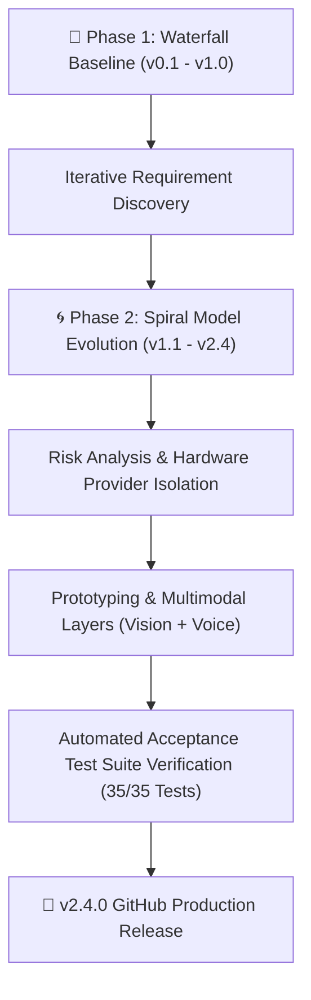
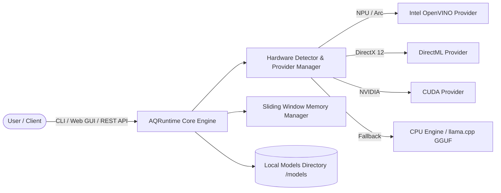

# ⚡ AQRuntime (Almudaya Quantum Runtime)

> **High-Performance, Heterogeneous Hardware Local AI Engine & Multimodal Control Center**  
> *Developed with pride by **Almudaya Quantum Labs***

---


---

## 🌟 About Almudaya Quantum Labs & The Vision Behind AQRuntime

**AQRuntime** (short for ***Almudaya Quantum Runtime***) is an open-source, lightweight, high-performance local AI runtime engineered by **Almudaya Quantum Labs**. 

The word **"Quantum"** in our startup's name represents our long-term scientific vision: *to pioneer the convergence of Artificial Intelligence, Decentralized Blockchain Infrastructure, and Quantum Circuit Computing into unified next-generation runtimes*, Inshaa Allah.

AQRuntime empowers users to discover, download, manage, and execute open-source Large Language Models (LLMs), Multimodal Vision Models, and Voice Speech Engines **100% locally on personal computers** without cloud dependencies, API keys, or data privacy risks.

---

## 🆚 Why AQRuntime? Detailed Comparison Matrix

How does **AQRuntime** compare against existing local AI tools like **Ollama** and **LM Studio**?

| Feature / Capability | ⚡ **AQRuntime** (Almudaya Quantum Labs) | 🦙 **Ollama** | 🖥️ **LM Studio** |
| :--- | :---: | :---: | :---: |
| **Intel NPU & Intel Arc Acceleration** | ✅ **Full Native Support** (*OpenVINO*) | ❌ Limited / Community experimental | ❌ Limited |
| **Pluggable Execution Provider Chain** | ✅ **Auto-Priority Fallback** (*NPU ➔ Arc ➔ DirectML ➔ CUDA ➔ CPU*) | ⚠️ Fixed CUDA/ROCm/CPU | ⚠️ Fixed GPU/CPU slider |
| **Multimodal Vision Canvas (`🖼️`)** | ✅ Built-in Live Thumbnail & Base64 API | ⚠️ CLI / Basic API | ✅ GUI Preview |
| **Voice Audio Speech-to-Text (`🎙️`)** | ✅ **Native Mic Recorder & STT Engine** | ❌ Not available | ❌ Not available |
| **Text-to-Speech Read Aloud (`🔊`)** | ✅ **Native Web Speech Synthesis TTS** | ❌ Not available | ❌ Not available |
| **Speed & Latency Telemetry (`⚡`)** | ✅ Real-time `tok/s`, `latency_seconds`, & RAM | ⚠️ Terminal text summary | ⚠️ Minimal header stats |
| **Document File Attachment (`📎`)** | ✅ Auto-Reader with Binary Protection & Safe Truncation | ❌ Manual copy-paste | ⚠️ File drop |
| **Persona Presets Gallery** | ✅ Built-in System Prompt Presets Dropdown | ⚠️ Modelfile customization | ⚠️ System Prompt box |
| **Dynamic Max Output Tokens Slider** | ✅ Configurable `64` to `8.192` Tokens | ⚠️ CLI flag parameter | ✅ Settings sidebar |
| **Headless OpenAI API Compatibility** | ✅ Native `/v1/chat/completions` REST API | ✅ Native `/v1/chat/completions` | ✅ Local API Server |
| **1-Click Markdown Export (`📥`)** | ✅ Instant Markdown Export | ❌ Manual copy-paste | ⚠️ Export chat |
| **Offline Privacy** | ✅ **100% Offline Local Storage** | ✅ Offline local | ✅ Offline local |
| **Open-Source Architecture** | ✅ **100% Open Source (Python/HTML5/C++)** | ✅ Open source | ❌ Closed source proprietary |

---

## 🔬 Scientific Software Engineering Methodology

The architecture of AQRuntime was designed following formal Software Engineering principles:



1. **Waterfall Foundation Model**:
   Development originated from formal, immutable **Documentation Baselines** located in the root repository. Each baseline cycle defined explicit specifications across 8 core architectural documents (`README.md.txt`, `MANIFEST.md.txt`, `REQUIREMENTS.md.txt`, `DESIGN.md.txt`, `DATABASE.md.txt`, `AI_SDK.md.txt`, `IMPLEMENTATION.md.txt`, `TESTING.md.txt`).

2. **Spiral Model Iterative Evolution**:
   As system complexity grew to support heterogeneous hardware acceleration (Intel OpenVINO, DirectML, CUDA, CPU), Multimodal Vision, and Voice Audio Engines, the development methodology scientifically transitioned into the **Spiral Model**. Each cycle evaluated hardware compatibility risks, added incremental capability layers, and validated regression safety through automated acceptance testing.

---

## 🚀 Key Feature Highlights (v2.4.0)

- 🎙️ **Voice Audio & Speech Engine**: Record voice prompts directly via microphone (`🎙️`) and listen to AI answers spoken aloud in natural human voice using Text-to-Speech (`🔊 Read Aloud`).
- 👁️ **Multimodal Vision Engine**: Upload images (`.png`, `.jpg`, `.webp`), preview thumbnails on a live canvas (`🖼️`), and run visual analysis models (e.g. `vikhyatk/moondream2`, `google/paligemma-3b-pt-224`).
- ⚡ **Heterogeneous Hardware Acceleration Engine**: Pluggable provider system with priority fallback (`Intel NPU` ➔ `Intel Arc iGPU` ➔ `DirectML` ➔ `CUDA` ➔ `CPU` ➔ `Cloud`).
- 🎚️ **Dynamic Max Tokens Control**: Adjust generation output limits dynamically from `64` up to `8.192` tokens via GUI slider or `--max-tokens` CLI option for long-form document drafting.
- 🏷️ **Explicit Quantization Badges**: Clear precision tags (`[GGUF Q4_K_M]`, `[GGUF Q5_K_M]`, `[GGUF Q8_0]`, `[FP16]`) for transparent memory estimation.
- 📖 **Comprehensive CLI Help Manual**: Explicit `aq help` command displaying formatted reference guides for all CLI options.

---

## 🏗️ System Architecture



---

## ⚡ Quick Start & Installation Guide

### Prerequisites
- Operating System: Windows 10/11, Linux, or macOS.
- Python: Version `3.10` or newer.

### 1. Installation

Clone the repository and install AQRuntime in an isolated Python environment:

```bash
# Clone repository
git clone https://github.com/elangbijak4/Almudaya-AQRuntime.git
cd Almudaya-AQRuntime

# Create & activate virtual environment
python -m venv .venv

# On Windows PowerShell:
.\.venv\Scripts\Activate.ps1

# On Linux/macOS:
source .venv/bin/activate

# Install AQRuntime in editable mode
python -m pip install -e .
```

### 2. Launch Web Control Center UI

```bash
aq ui
```
*Opens your web browser automatically at `http://127.0.0.1:8000/ui`.*

### 3. Launch Headless API Server (OpenAI Compatible)

```bash
aq serve --host 127.0.0.1 --port 8000
```

### 4. CLI Usage Examples

```bash
# Display comprehensive CLI help manual
aq help

# Perform system hardware diagnostic audit
aq doctor

# Discover models online/offline by category
aq discover vision
aq discover audio
aq discover nvidia

# Download a GGUF model with progress monitoring
aq pull bartowski/gemma-2-2b-it-GGUF

# List locally installed models
aq list

# Launch interactive CLI chat session with max tokens control
aq run bartowski/gemma-2-2b-it-GGUF --max-tokens 2048

# Inspect hardware execution providers
aq runtime list
aq runtime info intel-npu
```

---

## 📑 Documentation Roadmap & Deep Dive

For detailed technical documentation, hardware setup guides, and development history, inspect the following repository files:

- 📗 **User Guide & Detailed Manual**: [`docs/User_Guide.md`](docs/User_Guide.md)  
  *Contains complete step-by-step instructions for Web GUI tabs, CLI options, API endpoints, and troubleshooting.*
- 📜 **Living Development History Log**: [`docs/Development_History.md`](docs/Development_History.md)  
  *Detailed evolution log tracking feature additions across PoC v0.1 through PoC v2.4.*
- 🗂️ **Version Index & Baselines**: [`VERSION_INDEX.md.txt`](VERSION_INDEX.md.txt)  
  *Complete index of frozen documentation baselines (`AQRuntime PoC v0.1` through `AQRuntime PoC v2.4`).*
- 🔬 **Documentation Baselines**:  
  - [`AQRuntime PoC v2.4 – Documentation Baseline/`](AQRuntime%20PoC%20v2.4%20–%20Documentation%20Baseline/)

---

## 🔌 Capability Status

### Honest Feature Status

- **Text chat / OpenAI-compatible API**: supported
- **Streaming SSE**: supported
- **Generic tool calling**: supported
- **Document attachment with binary guard**: supported
- **Max tokens and telemetry**: supported, throughput is estimated
- **Voice STT**: API endpoint exists but transcription is still simulated
- **TTS Read Aloud**: browser Web Speech
- **Vision**: multimodal payload is parsed, image analysis is simulated
- **Audio endpoint**: simulated but OpenAI-style multipart endpoint works

## 🔌 OpenCode Compatibility

AQRuntime now exposes an OpenAI-compatible API suitable for local use with OpenCode:

- `/v1/chat/completions` with streaming
- full multi-turn messages
- optional generic tool/function calling adapter
- `/v1/audio/transcriptions` multipart endpoint
- `/v1/models` chat-only model catalog with capabilities

See `docs/OPENCODE_COMPATIBILITY_PATCHES.md` for full patch and test details.

## 🧪 Testing & Verification

Run the automated acceptance test suite to verify 100% system integrity:

```bash
.\.venv\Scripts\python.exe -m unittest discover -s tests -v
```

---

## 🛡️ Privacy & Security Statement

AQRuntime is designed with privacy as a foundational constraint:
- **Zero Telemetry Tracking**: AQRuntime does not collect analytics or user data.
- **Local Weight Storage**: Downloaded models are stored locally in `./models/`.
- **Offline Inference**: All prompt inference and chat sessions execute 100% locally on your machine.

---

## 🤝 Contributing & License

Contributions, feature requests, and bug reports are welcome!  
AQRuntime is released under the open-source **[MIT License](LICENSE)**.

**Built with passion by Almudaya Quantum Labs.**  
*Innovating the future of AI, Blockchain, and Quantum Computing.*
